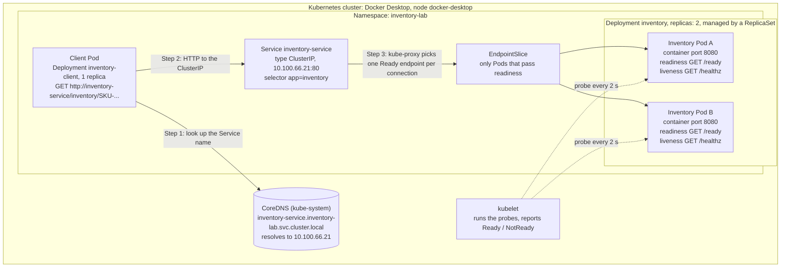
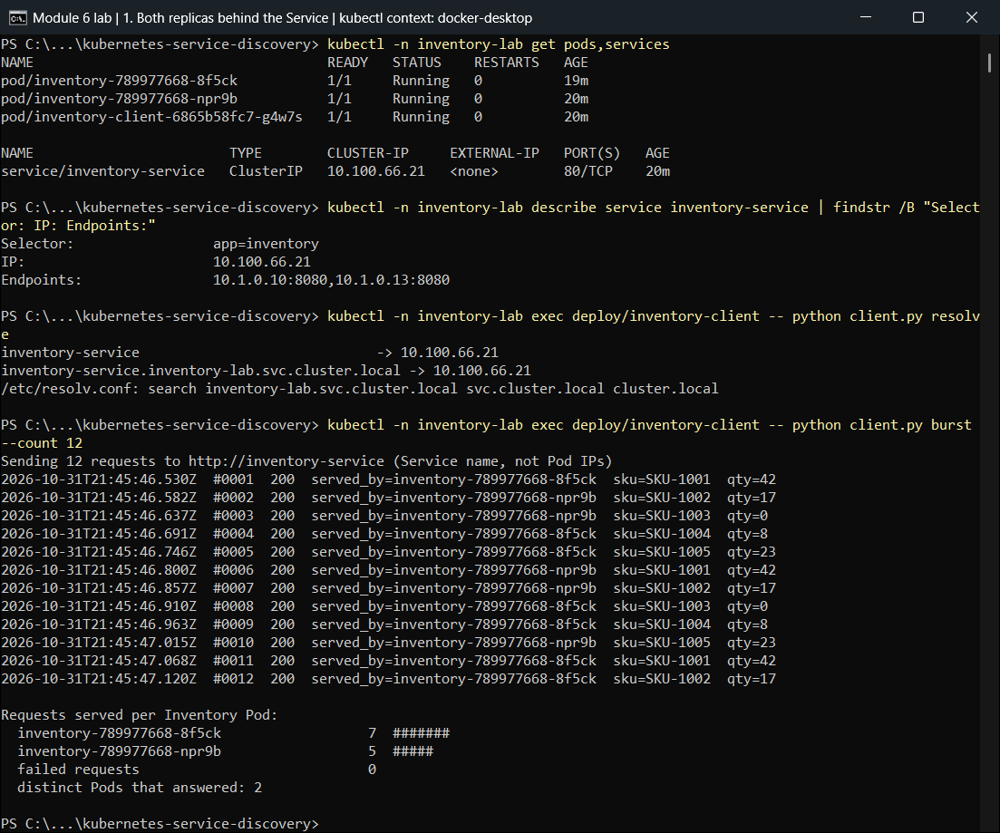
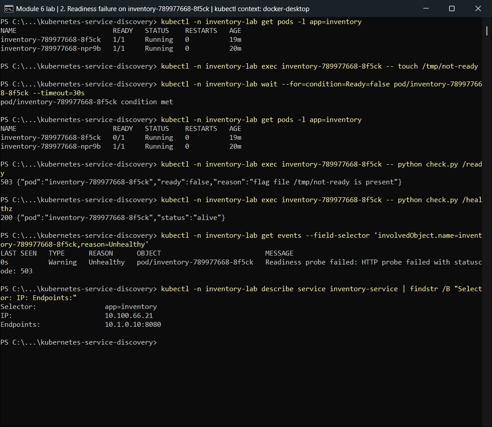
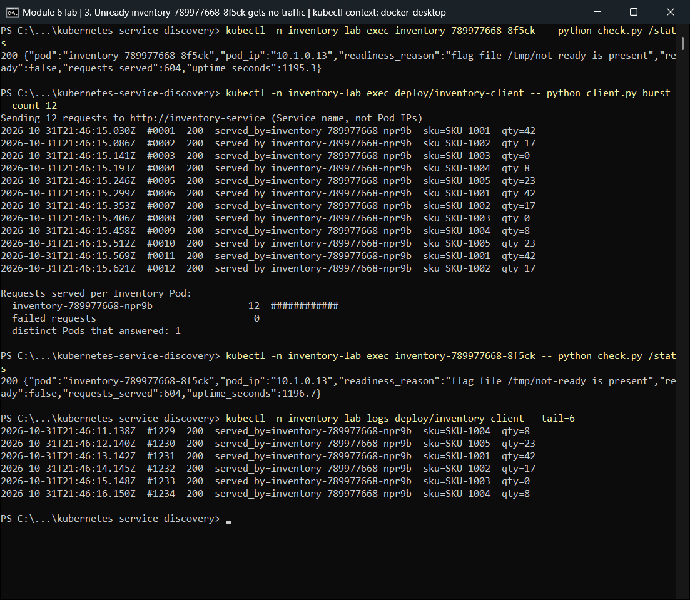
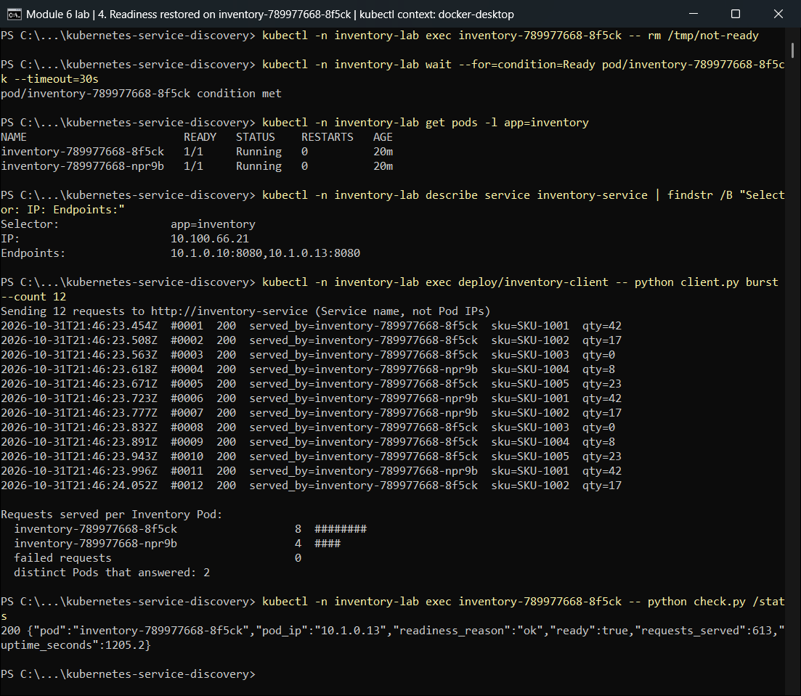
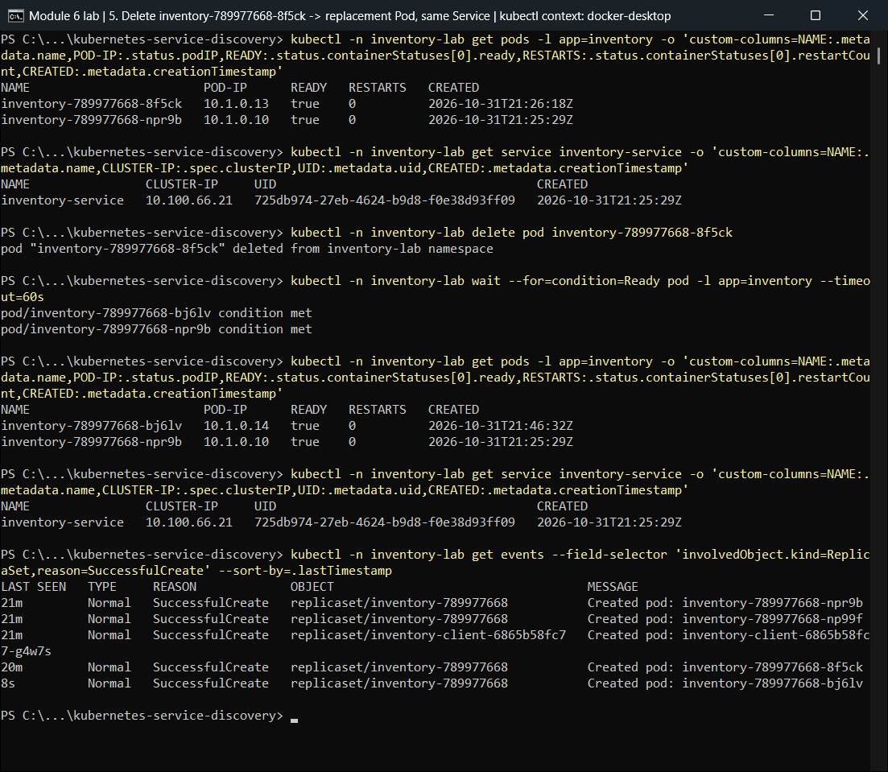
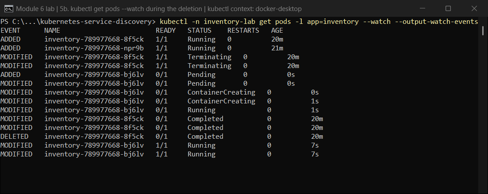
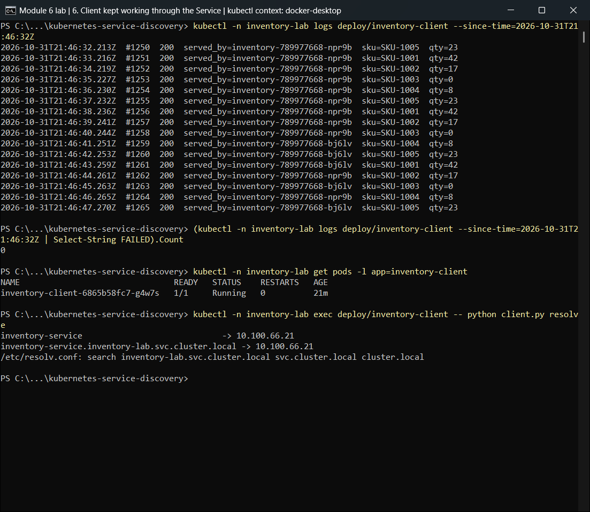

# Module 6: Kubernetes Service Discovery, Readiness and Pod Recovery

A small **Inventory Service** runs on Kubernetes as **2 replicas** behind one **Service** called `inventory-service`.
One **client** sends requests to Inventory **using only the Service name** (`http://inventory-service`). It never uses a Pod name or Pod IP.

The lab shows three things:

1. **Service discovery and load balancing:** the Service name resolves to one stable ClusterIP, and requests reach both replicas.
2. **Readiness:** a Pod that fails its readiness probe keeps **running** but stops receiving traffic. The other Pod keeps serving. When the failing Pod becomes ready again, it receives traffic again.
3. **Pod failure and recovery:** a deleted Pod is replaced by a **new Pod with a new name**. The **Service name stays the same**, and the client keeps working throughout.

**Cluster used:** Docker Desktop 4.88.1 Kubernetes (kubeadm, single node `docker-desktop`, Kubernetes v1.36.1) on Windows 11.
**Stack:** Python 3.13, Flask 3.1.3 + gunicorn 23.0.0 (Inventory), Python standard library only (client).

---

## Contents

- [Requirements checklist](#requirements-checklist)
- [Architecture](#architecture)
- [Repository layout](#repository-layout)
- [How it works](#how-it-works)
- [Deploying the application](#deploying-the-application)
- [Running the tests by hand](#running-the-tests-by-hand)
- [Evidence 1: deployment, Service name, both replicas](#evidence-1-deployment-service-name-both-replicas)
- [Evidence 2: readiness failure and recovery](#evidence-2-readiness-failure-and-recovery)
- [Evidence 3: Pod deletion and replacement](#evidence-3-pod-deletion-and-replacement)
- [Screenshots](#screenshots)
- [Observations](#observations)
- [Reflection](#reflection)
- [Cleanup](#cleanup)

---

## Requirements checklist

| # | Requirement | Where it is shown | Result |
|---|---|---|---|
| 1 | Deployment with **2 replicas** of Inventory | [`k8s/10-inventory-deployment.yaml`](k8s/10-inventory-deployment.yaml), [1.1](#11-both-inventory-pods-are-running) | `deployment.apps/inventory 2/2` |
| 1 | **Service** that exposes the replicas | [`k8s/20-inventory-service.yaml`](k8s/20-inventory-service.yaml), [1.2](#12-the-client-reaches-inventory-through-the-service-name) | ClusterIP `10.100.66.21`, selector `app=inventory` |
| 1 | Both Pods are running | [1.1](#11-both-inventory-pods-are-running) | both `1/1 Running` |
| 1 | Client accesses Inventory **using the Service name** | [`k8s/30-client-deployment.yaml`](k8s/30-client-deployment.yaml), [1.2](#12-the-client-reaches-inventory-through-the-service-name) | `INVENTORY_URL=http://inventory-service` resolves to the ClusterIP |
| 1 | Requests reach **more than one** replica | [1.3](#13-requests-reach-both-replicas) | 20 requests split **10 / 10** |
| 2 | **Readiness probe** on the Inventory Pods | [`k8s/10-inventory-deployment.yaml`](k8s/10-inventory-deployment.yaml), [How it works](#readiness-and-liveness) | `httpGet /ready` every 2 s |
| 2 | Make one Pod **fail readiness** | [2.1](#21-make-pod-a-fail-readiness) | `READY 0/1`, probe gets HTTP 503 |
| 2 | That Pod is **still running** | [2.2](#22-pod-a-is-still-running) | `STATUS Running`, `RESTARTS 0`, `/healthz` 200 |
| 2 | Unready Pod **stops receiving normal traffic** | [2.3](#23-pod-a-is-removed-from-the-service-endpoints), [2.4](#24-pod-a-receives-no-traffic-pod-b-keeps-serving) | out of the EndpointSlice; request counter **22 → 22** |
| 2 | Other ready Pod **continues serving** | [2.4](#24-pod-a-receives-no-traffic-pod-b-keeps-serving) | 20 / 20 answered by Pod B, 0 failed |
| 2 | Restore readiness, Pod **receives traffic again** | [2.5](#25-restore-readiness-pod-a-receives-traffic-again) | same Pod back to `1/1`, split **11 / 9** |
| 3 | **Delete** one Inventory Pod | [3.1](#31-before-the-deletion), [3.2](#32-delete-pod-a-and-kubernetes-creates-a-replacement) | `kubectl delete pod inventory-789977668-np99f` |
| 3 | Kubernetes **creates a replacement** Pod | [3.2](#32-delete-pod-a-and-kubernetes-creates-a-replacement) | ReplicaSet event `Created pod: inventory-789977668-8f5ck` |
| 3 | New Pod has a **different identity / name** | [3.3](#33-the-replacement-has-a-new-identity) | new name, UID and IP |
| 3 | **Service name remains unchanged** | [3.4](#34-the-service-is-unchanged) | same name, ClusterIP, UID |
| 3 | Client **continues communicating** through the Service | [3.5](#35-the-client-kept-working-the-whole-time) | 0 failed requests during the replacement |
| README | Deploy instructions, architecture diagram, evidence, reflection | this file + [`evidence/`](evidence/) | ✔ |
| README | Screenshots, logs, or terminal output | [Screenshots](#screenshots) (7 PNGs) + terminal output and Pod logs in every Evidence section | ✔ |

---

## Architecture



**How a request flows**

1. The client only knows the name `inventory-service`. Cluster DNS (CoreDNS) resolves it to the Service's **ClusterIP** (`10.100.66.21`). It never resolves to a Pod IP.
2. The client connects to the ClusterIP on port 80.
3. kube-proxy forwards each new connection to port 8080 of one Pod listed as **ready** in the Service's EndpointSlice.
4. The kubelet runs each Pod's readiness probe. A Pod that fails it is marked NotReady and dropped from the EndpointSlice, so it gets no more traffic. The Pod itself keeps running.
5. The Deployment's ReplicaSet keeps exactly 2 Inventory Pods. If one disappears, it creates a new one, which joins the EndpointSlice once it passes readiness.

| Kubernetes object | Name | Purpose |
|---|---|---|
| Namespace | `inventory-lab` | keeps every lab object together; one command deletes them all |
| Deployment → ReplicaSet → 2 Pods | `inventory` | the Inventory Service replicas |
| Service (ClusterIP) | `inventory-service` | stable name + virtual IP in front of the Ready Inventory Pods |
| EndpointSlice | `inventory-service-xxxxx` | the live list of Pod IPs behind the Service (managed by Kubernetes) |
| Deployment → 1 Pod | `inventory-client` | the client, calls `http://inventory-service` once per second |

---

## Repository layout

```
.
├── inventory/                    Inventory Service (Flask + gunicorn)
│   ├── app.py                    REST API, readiness logic, per-Pod request counter
│   ├── check.py                  helper: query this Pod's own app on localhost (used with kubectl exec)
│   ├── requirements.txt
│   └── Dockerfile
├── client/                       Client (Python standard library only)
│   ├── client.py                 modes: loop (default) | burst --count N | resolve
│   └── Dockerfile
├── k8s/                          Kubernetes configuration (applied in file-name order)
│   ├── 00-namespace.yaml
│   ├── 10-inventory-deployment.yaml   2 replicas, readiness + liveness probes, preStop hook
│   ├── 20-inventory-service.yaml      ClusterIP Service "inventory-service"
│   └── 30-client-deployment.yaml      1 client, INVENTORY_URL=http://inventory-service
├── scripts/
│   ├── deploy.sh                 build images + deploy + wait for rollout
│   ├── demo.sh                   runs every test and writes evidence/*.txt
│   ├── cleanup.sh                deletes the namespace
│   └── screenshots/              capture.ps1 + scene.ps1: run each step in a PowerShell window and save it as PNG
├── evidence/                     unedited terminal output from scripts/demo.sh
│   ├── 01-deploy.txt
│   ├── 02-service-discovery.txt
│   ├── 03-readiness-failure.txt
│   ├── 04-readiness-recovery.txt
│   └── 05-pod-deletion.txt
└── screenshots/                  PowerShell window screenshots of a live run (see "Screenshots")
```

---

## How it works

### Inventory Service ([`inventory/app.py`](inventory/app.py))

| Endpoint | Used by | Behaviour |
|---|---|---|
| `GET /inventory/<sku>` | client | stock for one SKU. Every response includes **`served_by`** (the Pod name), `pod_ip` and `node`, taken from the Downward API |
| `GET /inventory` | client | the whole catalogue |
| `GET /ready` | **readiness probe** | `200` when ready; `503` during the 5-second start-up warm-up **or** while the file `/tmp/not-ready` exists |
| `GET /healthz` | **liveness probe** | always `200` while the process is up; it does **not** depend on readiness |
| `GET /stats` | demo (`kubectl exec … python check.py /stats`) | this Pod's request counter and readiness state |

Every request served is logged as `served GET /inventory/... (request #N)`. Readiness changes are logged once, as `READINESS -> NOT READY / READY`. Together these show in each Pod's own log exactly when it was getting traffic.

### Readiness and liveness

From [`k8s/10-inventory-deployment.yaml`](k8s/10-inventory-deployment.yaml):

```yaml
readinessProbe:            # may this Pod receive Service traffic right now?
  httpGet: { path: /ready, port: http }
  initialDelaySeconds: 1
  periodSeconds: 2         # checked every 2 s
  timeoutSeconds: 1
  successThreshold: 1      # 1 success  -> Ready again   (back in rotation within ~2 s)
  failureThreshold: 2      # 2 failures -> NotReady      (out of rotation within ~2-4 s)
livenessProbe:             # is the process alive? (independent of readiness)
  httpGet: { path: /healthz, port: http }
  initialDelaySeconds: 5
  periodSeconds: 10
  failureThreshold: 3
lifecycle:
  preStop:                 # on delete: keep serving 5 s while the Pod is removed from the endpoints
    exec: { command: ["sleep", "5"] }
```

* **Making a Pod fail readiness** without killing it: `kubectl exec <pod> -- touch /tmp/not-ready`. The app then answers `/ready` with 503, the kubelet marks the Pod NotReady, and the Service stops sending it traffic. Removing the file (`rm /tmp/not-ready`) restores it.
* **Liveness is kept separate on purpose.** If both probes used `/ready`, the kubelet would *restart* the container instead of just taking it out of rotation, and the Pod would not stay running.
* **Warm-up:** a brand-new Pod reports "not ready" for its first 5 seconds. A replacement Pod therefore gets no traffic until it can actually serve. This is visible in [3.2](#32-delete-pod-a-and-kubernetes-creates-a-replacement).
* **preStop `sleep 5`:** when a Pod is deleted it is marked *terminating* and removed from the Service right away. The hook keeps the old container answering for a few more seconds, so requests already on their way to it don't fail.

### Client ([`client/client.py`](client/client.py))

* Configured only with `INVENTORY_URL=http://inventory-service` (the Service name). No Pod names or IPs appear anywhere in the client or its manifest.
* Sends each request on a **new TCP connection** (`Connection: close`). kube-proxy load-balances per connection, so every request can land on a different Pod. A client that reused one keep-alive connection would stick to a single Pod.
* `loop` (default): 1 request per second forever. Its log is the "normal traffic" timeline used in every test.
* `burst --count 20`: sends 20 requests and prints how many each Pod served.
* `resolve`: shows what the Service name resolves to inside the Pod.

---

## Deploying the application

### Prerequisites

* **Docker Desktop** with **Kubernetes enabled**: Docker Desktop → ⚙ Settings → Kubernetes → *Enable Kubernetes* → cluster type **kubeadm** → *Apply*. Wait for the green **Kubernetes running** indicator.
* `kubectl` (installed with Docker Desktop) pointing at the `docker-desktop` context.
* Git Bash, if you want to use the scripts in `scripts/`. Every step below can also be typed directly into PowerShell.

```bash
kubectl config use-context docker-desktop
kubectl get nodes          # docker-desktop   Ready   control-plane
```

### Steps

**1. Clone the repository**

```bash
git clone https://github.com/juileegiramkar/Module-6-Assignment-Service-Discovery-Readiness-Recovery.git
cd Module-6-Assignment-Service-Discovery-Readiness-Recovery
```

**2. Build the two images.** No registry is needed: Docker Desktop's kubeadm cluster runs images straight from the local Docker image store, and the manifests use `imagePullPolicy: IfNotPresent`.

```bash
docker build -t inventory-service:1.0 inventory
docker build -t inventory-client:1.0 client
```

**3. Deploy Inventory first** (namespace, 2-replica Deployment, Service) and wait until both Pods are Ready.

```bash
kubectl apply -f k8s/00-namespace.yaml -f k8s/10-inventory-deployment.yaml -f k8s/20-inventory-service.yaml
kubectl -n inventory-lab rollout status deployment/inventory
```

**4. Deploy the client**

```bash
kubectl apply -f k8s/30-client-deployment.yaml
kubectl -n inventory-lab rollout status deployment/inventory-client
```

`kubectl apply -f k8s/` also works and deploys everything at once. The client's first few requests are then refused until the Inventory Pods finish their warm-up (see [Observations](#observations)).

**5. Check it works**

```bash
kubectl -n inventory-lab get deploy,pods,svc -o wide
kubectl -n inventory-lab logs deploy/inventory-client -f        # Ctrl+C to stop
```

**Shortcut:** `bash scripts/deploy.sh` runs steps 2–5.
**Re-run every test and regenerate `evidence/`:** `bash scripts/demo.sh` (takes about 1–2 minutes).

> **Using kind or minikube instead?** Load the images into the cluster after building them, then use the same `kubectl apply` commands:
> `kind load docker-image inventory-service:1.0 inventory-client:1.0` or
> `minikube image load inventory-service:1.0` and `minikube image load inventory-client:1.0`.

---

## Running the tests by hand

Get the Pod names first, then put them in place of `<pod-a>` / `<pod-b>`:

```bash
kubectl -n inventory-lab get pods -l app=inventory
```

**Both replicas receive requests**

```bash
kubectl -n inventory-lab exec deploy/inventory-client -- python client.py resolve
kubectl -n inventory-lab exec deploy/inventory-client -- python client.py burst --count 20
```

**Readiness failure and recovery**

```bash
kubectl -n inventory-lab exec <pod-a> -- touch /tmp/not-ready        # Pod A fails readiness
kubectl -n inventory-lab get pods -l app=inventory                   # Pod A: 0/1 Running, RESTARTS 0
kubectl -n inventory-lab get endpointslices -l kubernetes.io/service-name=inventory-service -o yaml
kubectl -n inventory-lab exec deploy/inventory-client -- python client.py burst --count 20   # only Pod B
kubectl -n inventory-lab exec <pod-a> -- rm /tmp/not-ready           # restore
kubectl -n inventory-lab exec deploy/inventory-client -- python client.py burst --count 20   # both again
```

> In **Git Bash** on Windows, run `export MSYS_NO_PATHCONV=1` first. Otherwise Git Bash rewrites `/tmp/not-ready` into a Windows path. PowerShell doesn't need this.

**Pod failure and recovery**

```bash
kubectl -n inventory-lab get pods -l app=inventory --watch           # in a second terminal
kubectl -n inventory-lab delete pod <pod-a>
kubectl -n inventory-lab get pods -l app=inventory                   # new Pod name
kubectl -n inventory-lab get service inventory-service               # same name and ClusterIP
kubectl -n inventory-lab logs deploy/inventory-client --since=1m     # no FAILED lines
```

---

## Evidence

Everything below is real terminal output from **one run of [`scripts/demo.sh`](scripts/demo.sh)** on **2026-10-31, 21:25–21:26 UTC**, against the `docker-desktop` context. The complete, unedited output of every step is in [`evidence/`](evidence/). Where a block below is shortened, it says `…` and points to the file. Screenshots of a second, live run of the same three tests are in [Screenshots](#screenshots).

Pods in this run:

| Role | Pod name | Pod IP |
|---|---|---|
| Inventory **Pod A** (fails readiness, later deleted) | `inventory-789977668-np99f` | 10.1.0.11 |
| Inventory **Pod B** | `inventory-789977668-npr9b` | 10.1.0.10 |
| Inventory **replacement** for Pod A | `inventory-789977668-8f5ck` | 10.1.0.13 |
| Client | `inventory-client-6865b58fc7-g4w7s` | 10.1.0.12 |
| **Service** `inventory-service` | ClusterIP **10.100.66.21** | port 80 → 8080 |

---

## Evidence 1: deployment, Service name, both replicas

Full output: [`evidence/01-deploy.txt`](evidence/01-deploy.txt), [`evidence/02-service-discovery.txt`](evidence/02-service-discovery.txt)

### 1.1 Both Inventory Pods are running

```text
$ kubectl version
Client Version: v1.36.1
Kustomize Version: v5.8.1
Server Version: v1.36.1

$ kubectl apply -f k8s/00-namespace.yaml -f k8s/10-inventory-deployment.yaml -f k8s/20-inventory-service.yaml
namespace/inventory-lab created
deployment.apps/inventory created
service/inventory-service created

$ kubectl -n inventory-lab rollout status deployment/inventory --timeout=120s
Waiting for deployment "inventory" rollout to finish: 0 of 2 updated replicas are available...
Waiting for deployment "inventory" rollout to finish: 1 of 2 updated replicas are available...
deployment "inventory" successfully rolled out

$ kubectl apply -f k8s/30-client-deployment.yaml
deployment.apps/inventory-client created

$ kubectl -n inventory-lab get deployments,replicasets -o wide
NAME                               READY   UP-TO-DATE   AVAILABLE   AGE   CONTAINERS   IMAGES                  SELECTOR
deployment.apps/inventory          2/2     2            2           9s    inventory    inventory-service:1.0   app=inventory
deployment.apps/inventory-client   1/1     1            1           1s    client       inventory-client:1.0    app=inventory-client

NAME                                          DESIRED   CURRENT   READY   AGE   CONTAINERS   IMAGES                  SELECTOR
replicaset.apps/inventory-789977668           2         2         2       9s    inventory    inventory-service:1.0   app=inventory,pod-template-hash=789977668
replicaset.apps/inventory-client-6865b58fc7   1         1         1       1s    client       inventory-client:1.0    app=inventory-client,pod-template-hash=6865b58fc7

$ kubectl -n inventory-lab get pods -o wide
NAME                                READY   STATUS    RESTARTS   AGE   IP          NODE             NOMINATED NODE   READINESS GATES
inventory-789977668-np99f           1/1     Running   0          9s    10.1.0.11   docker-desktop   <none>           <none>
inventory-789977668-npr9b           1/1     Running   0          9s    10.1.0.10   docker-desktop   <none>           <none>
inventory-client-6865b58fc7-g4w7s   1/1     Running   0          1s    10.1.0.12   docker-desktop   <none>           <none>
```

### 1.2 The client reaches Inventory through the Service name

The Service has one stable ClusterIP, and its EndpointSlice lists both Inventory Pods as ready:

```text
$ kubectl -n inventory-lab get service inventory-service -o wide
NAME                TYPE        CLUSTER-IP     EXTERNAL-IP   PORT(S)   AGE   SELECTOR
inventory-service   ClusterIP   10.100.66.21   <none>        80/TCP    9s    app=inventory

$ kubectl -n inventory-lab get endpointslices -l kubernetes.io/service-name=inventory-service -o jsonpath='{range .items[*].endpoints[*]}{.targetRef.name}{"  ip="}{.addresses[0]}{"  ready="}{.conditions.ready}{"  serving="}{.conditions.serving}{"  terminating="}{.conditions.terminating}{"\n"}{end}'
inventory-789977668-npr9b  ip=10.1.0.10  ready=true  serving=true  terminating=false
inventory-789977668-np99f  ip=10.1.0.11  ready=true  serving=true  terminating=false
```

The client is configured with the Service name only. Inside the client Pod, cluster DNS turns that name, and its full form, into the **ClusterIP**, not into a Pod IP:

```text
$ kubectl -n inventory-lab get deployment inventory-client -o jsonpath='{.spec.template.spec.containers[0].env[0]}{"\n"}'
{"name":"INVENTORY_URL","value":"http://inventory-service"}

$ kubectl -n inventory-lab exec deploy/inventory-client -- printenv INVENTORY_URL
http://inventory-service

$ kubectl -n inventory-lab exec deploy/inventory-client -- python client.py resolve
inventory-service                             -> 10.100.66.21
inventory-service.inventory-lab.svc.cluster.local -> 10.100.66.21
/etc/resolv.conf: search inventory-lab.svc.cluster.local svc.cluster.local cluster.local
```

### 1.3 Requests reach both replicas

20 requests from the client to `http://inventory-service`. Each reply says which Pod served it, and the two replicas served **10 each**:

```text
$ kubectl -n inventory-lab exec deploy/inventory-client -- python client.py burst --count 20
Sending 20 requests to http://inventory-service (Service name, not Pod IPs)
2026-10-31T21:25:41.028Z  #0001  200  served_by=inventory-789977668-npr9b  sku=SKU-1001  qty=42
2026-10-31T21:25:41.084Z  #0002  200  served_by=inventory-789977668-npr9b  sku=SKU-1002  qty=17
2026-10-31T21:25:41.139Z  #0003  200  served_by=inventory-789977668-np99f  sku=SKU-1003  qty=0
2026-10-31T21:25:41.196Z  #0004  200  served_by=inventory-789977668-np99f  sku=SKU-1004  qty=8
2026-10-31T21:25:41.248Z  #0005  200  served_by=inventory-789977668-np99f  sku=SKU-1005  qty=23
2026-10-31T21:25:41.304Z  #0006  200  served_by=inventory-789977668-npr9b  sku=SKU-1001  qty=42
2026-10-31T21:25:41.358Z  #0007  200  served_by=inventory-789977668-np99f  sku=SKU-1002  qty=17
2026-10-31T21:25:41.411Z  #0008  200  served_by=inventory-789977668-npr9b  sku=SKU-1003  qty=0
2026-10-31T21:25:41.466Z  #0009  200  served_by=inventory-789977668-np99f  sku=SKU-1004  qty=8
2026-10-31T21:25:41.518Z  #0010  200  served_by=inventory-789977668-np99f  sku=SKU-1005  qty=23
2026-10-31T21:25:41.573Z  #0011  200  served_by=inventory-789977668-npr9b  sku=SKU-1001  qty=42
2026-10-31T21:25:41.629Z  #0012  200  served_by=inventory-789977668-npr9b  sku=SKU-1002  qty=17
2026-10-31T21:25:41.684Z  #0013  200  served_by=inventory-789977668-npr9b  sku=SKU-1003  qty=0
2026-10-31T21:25:41.737Z  #0014  200  served_by=inventory-789977668-np99f  sku=SKU-1004  qty=8
2026-10-31T21:25:41.789Z  #0015  200  served_by=inventory-789977668-np99f  sku=SKU-1005  qty=23
2026-10-31T21:25:41.841Z  #0016  200  served_by=inventory-789977668-npr9b  sku=SKU-1001  qty=42
2026-10-31T21:25:41.894Z  #0017  200  served_by=inventory-789977668-np99f  sku=SKU-1002  qty=17
2026-10-31T21:25:41.946Z  #0018  200  served_by=inventory-789977668-npr9b  sku=SKU-1003  qty=0
2026-10-31T21:25:42.000Z  #0019  200  served_by=inventory-789977668-npr9b  sku=SKU-1004  qty=8
2026-10-31T21:25:42.055Z  #0020  200  served_by=inventory-789977668-np99f  sku=SKU-1005  qty=23

Requests served per Inventory Pod:
  inventory-789977668-np99f                 10  ##########
  inventory-789977668-npr9b                 10  ##########
  failed requests                            0
  distinct Pods that answered: 2
```

The client's own continuous loop (1 request/second) is spread over both Pods too, and has had no failures since it started:

```text
$ kubectl -n inventory-lab logs deploy/inventory-client --tail=12
2026-10-31T21:25:38.685Z  #0001  200  served_by=inventory-789977668-npr9b  sku=SKU-1001  qty=42
2026-10-31T21:25:39.688Z  #0002  200  served_by=inventory-789977668-np99f  sku=SKU-1002  qty=17
2026-10-31T21:25:40.691Z  #0003  200  served_by=inventory-789977668-np99f  sku=SKU-1003  qty=0
2026-10-31T21:25:41.694Z  #0004  200  served_by=inventory-789977668-np99f  sku=SKU-1004  qty=8
2026-10-31T21:25:42.699Z  #0005  200  served_by=inventory-789977668-np99f  sku=SKU-1005  qty=23
2026-10-31T21:25:43.705Z  #0006  200  served_by=inventory-789977668-np99f  sku=SKU-1001  qty=42
2026-10-31T21:25:44.708Z  #0007  200  served_by=inventory-789977668-np99f  sku=SKU-1002  qty=17
2026-10-31T21:25:45.710Z  #0008  200  served_by=inventory-789977668-np99f  sku=SKU-1003  qty=0
2026-10-31T21:25:46.714Z  #0009  200  served_by=inventory-789977668-npr9b  sku=SKU-1004  qty=8
2026-10-31T21:25:47.720Z  #0010  200  served_by=inventory-789977668-np99f  sku=SKU-1005  qty=23
2026-10-31T21:25:48.724Z  #0011  200  served_by=inventory-789977668-np99f  sku=SKU-1001  qty=42
2026-10-31T21:25:49.726Z  #0012  200  served_by=inventory-789977668-npr9b  sku=SKU-1002  qty=17

$ kubectl -n inventory-lab logs deploy/inventory-client | grep -c FAILED
0
```

Each Inventory Pod's own log and request counter confirm it served requests:

```text
$ kubectl -n inventory-lab logs inventory-789977668-np99f --tail=6
2026-10-31T21:25:43.704Z  [inventory-789977668-np99f] served GET /inventory/SKU-1001 -> 200 qty=42 (request #15)
2026-10-31T21:25:44.707Z  [inventory-789977668-np99f] served GET /inventory/SKU-1002 -> 200 qty=17 (request #16)
2026-10-31T21:25:45.709Z  [inventory-789977668-np99f] served GET /inventory/SKU-1003 -> 200 qty=0 (request #17)
2026-10-31T21:25:47.719Z  [inventory-789977668-np99f] served GET /inventory/SKU-1005 -> 200 qty=23 (request #18)
2026-10-31T21:25:48.723Z  [inventory-789977668-np99f] served GET /inventory/SKU-1001 -> 200 qty=42 (request #19)
2026-10-31T21:25:50.727Z  [inventory-789977668-np99f] served GET /inventory/SKU-1003 -> 200 qty=0 (request #20)

$ kubectl -n inventory-lab logs inventory-789977668-npr9b --tail=6
2026-10-31T21:25:41.683Z  [inventory-789977668-npr9b] served GET /inventory/SKU-1003 -> 200 qty=0 (request #8)
2026-10-31T21:25:41.841Z  [inventory-789977668-npr9b] served GET /inventory/SKU-1001 -> 200 qty=42 (request #9)
2026-10-31T21:25:41.946Z  [inventory-789977668-npr9b] served GET /inventory/SKU-1003 -> 200 qty=0 (request #10)
2026-10-31T21:25:41.999Z  [inventory-789977668-npr9b] served GET /inventory/SKU-1004 -> 200 qty=8 (request #11)
2026-10-31T21:25:46.713Z  [inventory-789977668-npr9b] served GET /inventory/SKU-1004 -> 200 qty=8 (request #12)
2026-10-31T21:25:49.725Z  [inventory-789977668-npr9b] served GET /inventory/SKU-1002 -> 200 qty=17 (request #13)

$ kubectl -n inventory-lab exec inventory-789977668-np99f -- python check.py /stats
200 {"pod":"inventory-789977668-np99f","pod_ip":"10.1.0.11","readiness_reason":"ok","ready":true,"requests_served":20,"uptime_seconds":20.1}

$ kubectl -n inventory-lab exec inventory-789977668-npr9b -- python check.py /stats
200 {"pod":"inventory-789977668-npr9b","pod_ip":"10.1.0.10","readiness_reason":"ok","ready":true,"requests_served":14,"uptime_seconds":20.6}
```

---

## Evidence 2: readiness failure and recovery

Full output: [`evidence/03-readiness-failure.txt`](evidence/03-readiness-failure.txt), [`evidence/04-readiness-recovery.txt`](evidence/04-readiness-recovery.txt)

### 2.1 Make Pod A fail readiness

Both Pods start out Ready. Creating the flag file inside Pod A's running container makes its `/ready` endpoint return 503:

```text
$ kubectl -n inventory-lab get pods -l app=inventory -o wide
NAME                        READY   STATUS    RESTARTS   AGE   IP          NODE             NOMINATED NODE   READINESS GATES
inventory-789977668-np99f   1/1     Running   0          23s   10.1.0.11   docker-desktop   <none>           <none>
inventory-789977668-npr9b   1/1     Running   0          23s   10.1.0.10   docker-desktop   <none>           <none>

$ kubectl -n inventory-lab exec inventory-789977668-np99f -- touch /tmp/not-ready

$ kubectl -n inventory-lab wait --for=condition=Ready=false pod/inventory-789977668-np99f --timeout=30s
pod/inventory-789977668-np99f condition met
```

### 2.2 Pod A is still running

`READY` is `0/1`, but `STATUS` is still `Running` and `RESTARTS` is `0`. The container is up and was never restarted. Only the Pod's *Ready* condition is False:

```text
$ kubectl -n inventory-lab get pods -l app=inventory -o wide
NAME                        READY   STATUS    RESTARTS   AGE   IP          NODE             NOMINATED NODE   READINESS GATES
inventory-789977668-np99f   0/1     Running   0          27s   10.1.0.11   docker-desktop   <none>           <none>
inventory-789977668-npr9b   1/1     Running   0          27s   10.1.0.10   docker-desktop   <none>           <none>

$ kubectl -n inventory-lab get pod inventory-789977668-np99f -o jsonpath='phase={.status.phase}  containerStarted={.status.containerStatuses[0].started}  containerReady={.status.containerStatuses[0].ready}  restarts={.status.containerStatuses[0].restartCount}{"\n"}'
phase=Running  containerStarted=true  containerReady=false  restarts=0

$ kubectl -n inventory-lab get pod inventory-789977668-np99f -o jsonpath='{range .status.conditions[*]}{.type}={.status}{"\n"}{end}'
PodReadyToStartContainers=True
Initialized=True
Ready=False
ContainersReady=False
PodScheduled=True
```

The kubelet's readiness probe is getting HTTP 503, while the liveness endpoint still answers 200 (so the Pod isn't killed):

```text
$ kubectl -n inventory-lab get events --field-selector involvedObject.name=inventory-789977668-np99f,reason=Unhealthy
LAST SEEN   TYPE      REASON      OBJECT                          MESSAGE
2s          Warning   Unhealthy   pod/inventory-789977668-np99f   Readiness probe failed: HTTP probe failed with statuscode: 503

$ kubectl -n inventory-lab exec inventory-789977668-np99f -- python check.py /ready
503 {"pod":"inventory-789977668-np99f","ready":false,"reason":"flag file /tmp/not-ready is present"}

$ kubectl -n inventory-lab exec inventory-789977668-np99f -- python check.py /healthz
200 {"pod":"inventory-789977668-np99f","status":"alive"}
```

### 2.3 Pod A is removed from the Service endpoints

Pod A is still listed in the EndpointSlice, but as `ready=false`. The Service's endpoint list now contains **only Pod B** (`10.1.0.10`). The ClusterIP has not changed:

```text
$ kubectl -n inventory-lab get endpointslices -l kubernetes.io/service-name=inventory-service -o jsonpath='{range .items[*].endpoints[*]}{.targetRef.name}{"  ip="}{.addresses[0]}{"  ready="}{.conditions.ready}{"  serving="}{.conditions.serving}{"  terminating="}{.conditions.terminating}{"\n"}{end}'
inventory-789977668-npr9b  ip=10.1.0.10  ready=true  serving=true  terminating=false
inventory-789977668-np99f  ip=10.1.0.11  ready=false  serving=false  terminating=false

$ kubectl -n inventory-lab describe service inventory-service | grep -E '^(IP|Endpoints):'
IP:                       10.100.66.21
Endpoints:                10.1.0.10:8080
```

### 2.4 Pod A receives no traffic, Pod B keeps serving

Pod A's request counter is **22** before the test traffic:

```text
$ kubectl -n inventory-lab exec inventory-789977668-np99f -- python check.py /stats
200 {"pod":"inventory-789977668-np99f","pod_ip":"10.1.0.11","readiness_reason":"flag file /tmp/not-ready is present","ready":false,"requests_served":22,"uptime_seconds":27.3}
```

20 requests through the Service. **All 20** were answered by Pod B, and none failed:

```text
$ kubectl -n inventory-lab exec deploy/inventory-client -- python client.py burst --count 20
Sending 20 requests to http://inventory-service (Service name, not Pod IPs)
2026-10-31T21:25:59.047Z  #0001  200  served_by=inventory-789977668-npr9b  sku=SKU-1001  qty=42
2026-10-31T21:25:59.101Z  #0002  200  served_by=inventory-789977668-npr9b  sku=SKU-1002  qty=17
2026-10-31T21:25:59.154Z  #0003  200  served_by=inventory-789977668-npr9b  sku=SKU-1003  qty=0
…  (#0004 to #0019 also served_by=inventory-789977668-npr9b, see evidence/03-readiness-failure.txt)
2026-10-31T21:26:00.048Z  #0020  200  served_by=inventory-789977668-npr9b  sku=SKU-1005  qty=23

Requests served per Inventory Pod:
  inventory-789977668-npr9b                 20  ####################
  failed requests                            0
  distinct Pods that answered: 1
```

The client's normal 1-per-second traffic, from the moment Pod A became NotReady, also went only to Pod B, with no errors:

```text
$ kubectl -n inventory-lab logs deploy/inventory-client --since-time=2026-10-31T21:25:56Z
2026-10-31T21:25:57.757Z  #0020  200  served_by=inventory-789977668-npr9b  sku=SKU-1005  qty=23
2026-10-31T21:25:58.759Z  #0021  200  served_by=inventory-789977668-npr9b  sku=SKU-1001  qty=42
2026-10-31T21:25:59.761Z  #0022  200  served_by=inventory-789977668-npr9b  sku=SKU-1002  qty=17
2026-10-31T21:26:00.767Z  #0023  200  served_by=inventory-789977668-npr9b  sku=SKU-1003  qty=0
2026-10-31T21:26:01.770Z  #0024  200  served_by=inventory-789977668-npr9b  sku=SKU-1004  qty=8
2026-10-31T21:26:02.775Z  #0025  200  served_by=inventory-789977668-npr9b  sku=SKU-1005  qty=23
2026-10-31T21:26:03.778Z  #0026  200  served_by=inventory-789977668-npr9b  sku=SKU-1001  qty=42
```

After all that traffic, Pod A's counter is **still 22**: it received **no** normal traffic while unready. Its own log shows the switch to NOT READY, and no requests served after it was taken out of rotation:

```text
$ kubectl -n inventory-lab exec inventory-789977668-np99f -- python check.py /stats
200 {"pod":"inventory-789977668-np99f","pod_ip":"10.1.0.11","readiness_reason":"flag file /tmp/not-ready is present","ready":false,"requests_served":22,"uptime_seconds":33.6}

$ kubectl -n inventory-lab logs inventory-789977668-np99f --since-time=2026-10-31T21:25:52Z
2026-10-31T21:25:52.734Z  [inventory-789977668-np99f] served GET /inventory/SKU-1005 -> 200 qty=23 (request #21)
2026-10-31T21:25:53.447Z  [inventory-789977668-np99f] READINESS -> NOT READY (flag file /tmp/not-ready is present)
2026-10-31T21:25:53.737Z  [inventory-789977668-np99f] served GET /inventory/SKU-1001 -> 200 qty=42 (request #22)

$ kubectl -n inventory-lab logs inventory-789977668-np99f --since-time=2026-10-31T21:25:56Z | grep -c 'served GET'
0
```

> Request #22 arrived 0.3 s *after* the first failed probe. That's expected: with `failureThreshold: 2`, the kubelet waits for a **second** failed probe (2 s later) before it marks the Pod NotReady. Once that happened (21:25:56), Pod A served nothing.

### 2.5 Restore readiness: Pod A receives traffic again

Removing the flag file makes the next probe succeed, and Pod A is Ready again. It is the **same Pod** (same name, IP, `RESTARTS 0`), not a new one:

```text
$ kubectl -n inventory-lab exec inventory-789977668-np99f -- rm /tmp/not-ready

$ kubectl -n inventory-lab wait --for=condition=Ready pod/inventory-789977668-np99f --timeout=30s
pod/inventory-789977668-np99f condition met

$ kubectl -n inventory-lab get pods -l app=inventory -o wide
NAME                        READY   STATUS    RESTARTS   AGE   IP          NODE             NOMINATED NODE   READINESS GATES
inventory-789977668-np99f   1/1     Running   0          39s   10.1.0.11   docker-desktop   <none>           <none>
inventory-789977668-npr9b   1/1     Running   0          39s   10.1.0.10   docker-desktop   <none>           <none>

$ kubectl -n inventory-lab get endpointslices -l kubernetes.io/service-name=inventory-service -o jsonpath='{range .items[*].endpoints[*]}{.targetRef.name}{"  ip="}{.addresses[0]}{"  ready="}{.conditions.ready}{"  serving="}{.conditions.serving}{"  terminating="}{.conditions.terminating}{"\n"}{end}'
inventory-789977668-npr9b  ip=10.1.0.10  ready=true  serving=true  terminating=false
inventory-789977668-np99f  ip=10.1.0.11  ready=true  serving=true  terminating=false

$ kubectl -n inventory-lab describe service inventory-service | grep -E '^(IP|Endpoints):'
IP:                       10.100.66.21
Endpoints:                10.1.0.10:8080,10.1.0.11:8080
```

Traffic through the Service reaches **both Pods again** (11 / 9):

```text
$ kubectl -n inventory-lab exec deploy/inventory-client -- python client.py burst --count 20
Sending 20 requests to http://inventory-service (Service name, not Pod IPs)
2026-10-31T21:26:09.381Z  #0001  200  served_by=inventory-789977668-npr9b  sku=SKU-1001  qty=42
2026-10-31T21:26:09.434Z  #0002  200  served_by=inventory-789977668-npr9b  sku=SKU-1002  qty=17
2026-10-31T21:26:09.487Z  #0003  200  served_by=inventory-789977668-np99f  sku=SKU-1003  qty=0
2026-10-31T21:26:09.541Z  #0004  200  served_by=inventory-789977668-np99f  sku=SKU-1004  qty=8
2026-10-31T21:26:09.593Z  #0005  200  served_by=inventory-789977668-np99f  sku=SKU-1005  qty=23
…  (#0006 to #0019 omitted, see evidence/04-readiness-recovery.txt)
2026-10-31T21:26:10.391Z  #0020  200  served_by=inventory-789977668-np99f  sku=SKU-1005  qty=23

Requests served per Inventory Pod:
  inventory-789977668-np99f                 11  ###########
  inventory-789977668-npr9b                  9  #########
  failed requests                            0
  distinct Pods that answered: 2

$ kubectl -n inventory-lab logs deploy/inventory-client --since-time=2026-10-31T21:26:08Z
2026-10-31T21:26:08.797Z  #0031  200  served_by=inventory-789977668-npr9b  sku=SKU-1001  qty=42
2026-10-31T21:26:09.801Z  #0032  200  served_by=inventory-789977668-np99f  sku=SKU-1002  qty=17
2026-10-31T21:26:10.805Z  #0033  200  served_by=inventory-789977668-np99f  sku=SKU-1003  qty=0
2026-10-31T21:26:11.807Z  #0034  200  served_by=inventory-789977668-npr9b  sku=SKU-1004  qty=8
2026-10-31T21:26:12.811Z  #0035  200  served_by=inventory-789977668-npr9b  sku=SKU-1005  qty=23
2026-10-31T21:26:13.821Z  #0036  200  served_by=inventory-789977668-np99f  sku=SKU-1001  qty=42
```

Pod A's own log shows `READY` again followed straight away by served requests. Its counter went from 22 to **38**:

```text
$ kubectl -n inventory-lab logs inventory-789977668-np99f --since-time=2026-10-31T21:26:05Z
2026-10-31T21:26:07.451Z  [inventory-789977668-np99f] READINESS -> READY (ok)
2026-10-31T21:26:07.793Z  [inventory-789977668-np99f] served GET /inventory/SKU-1005 -> 200 qty=23 (request #23)
2026-10-31T21:26:09.486Z  [inventory-789977668-np99f] served GET /inventory/SKU-1003 -> 200 qty=0 (request #24)
…  (requests #25 to #37, see evidence/04-readiness-recovery.txt)
2026-10-31T21:26:14.822Z  [inventory-789977668-np99f] served GET /inventory/SKU-1002 -> 200 qty=17 (request #38)

$ kubectl -n inventory-lab exec inventory-789977668-np99f -- python check.py /stats
200 {"pod":"inventory-789977668-np99f","pod_ip":"10.1.0.11","readiness_reason":"ok","ready":true,"requests_served":38,"uptime_seconds":44.0}
```

---

## Evidence 3: Pod deletion and replacement

Full output: [`evidence/05-pod-deletion.txt`](evidence/05-pod-deletion.txt)

### 3.1 Before the deletion

```text
$ kubectl -n inventory-lab get pods -l app=inventory -o custom-columns=NAME:.metadata.name,UID:.metadata.uid,POD-IP:.status.podIP,PHASE:.status.phase,READY:.status.containerStatuses[0].ready,RESTARTS:.status.containerStatuses[0].restartCount,CREATED:.metadata.creationTimestamp
NAME                        UID                                    POD-IP      PHASE     READY   RESTARTS   CREATED
inventory-789977668-np99f   ffcfd845-b911-45a6-9aac-0ba8fcbf752c   10.1.0.11   Running   true    0          2026-10-31T21:25:29Z
inventory-789977668-npr9b   bf338981-ae25-4122-aca0-7699a4bb7f3f   10.1.0.10   Running   true    0          2026-10-31T21:25:29Z

$ kubectl -n inventory-lab get service inventory-service -o custom-columns=NAME:.metadata.name,CLUSTER-IP:.spec.clusterIP,PORT:.spec.ports[0].port,UID:.metadata.uid,CREATED:.metadata.creationTimestamp
NAME                CLUSTER-IP     PORT   UID                                    CREATED
inventory-service   10.100.66.21   80     725db974-27eb-4624-b9d8-f0e38d93ff09   2026-10-31T21:25:29Z
```

### 3.2 Delete Pod A, and Kubernetes creates a replacement

One second after the delete, Pod A is `Terminating`, and the ReplicaSet has **already started a replacement** (`8f5ck`, still `0/1` while it warms up). The EndpointSlice shows the hand-over:
- Pod A is `terminating=true, ready=false`: no new traffic, but the preStop hook keeps it `serving` in-flight requests.
- The new Pod is not ready yet.
- Pod B carries all the traffic.

```text
$ kubectl -n inventory-lab delete pod inventory-789977668-np99f --wait=false
pod "inventory-789977668-np99f" deleted from inventory-lab namespace

$ kubectl -n inventory-lab get pods -l app=inventory -o wide
NAME                        READY   STATUS        RESTARTS   AGE   IP          NODE             NOMINATED NODE   READINESS GATES
inventory-789977668-8f5ck   0/1     Running       0          1s    10.1.0.13   docker-desktop   <none>           <none>
inventory-789977668-np99f   1/1     Terminating   0          50s   10.1.0.11   docker-desktop   <none>           <none>
inventory-789977668-npr9b   1/1     Running       0          50s   10.1.0.10   docker-desktop   <none>           <none>

$ kubectl -n inventory-lab get endpointslices -l kubernetes.io/service-name=inventory-service -o jsonpath='{range .items[*].endpoints[*]}{.targetRef.name}{"  ip="}{.addresses[0]}{"  ready="}{.conditions.ready}{"  serving="}{.conditions.serving}{"  terminating="}{.conditions.terminating}{"\n"}{end}'
inventory-789977668-npr9b  ip=10.1.0.10  ready=true  serving=true  terminating=false
inventory-789977668-np99f  ip=10.1.0.11  ready=false  serving=true  terminating=true
inventory-789977668-8f5ck  ip=10.1.0.13  ready=false  serving=false  terminating=false

$ kubectl -n inventory-lab wait --for=delete pod/inventory-789977668-np99f --timeout=60s
pod/inventory-789977668-np99f condition met

$ kubectl -n inventory-lab wait --for=condition=Ready pod -l app=inventory --timeout=60s
pod/inventory-789977668-8f5ck condition met
pod/inventory-789977668-npr9b condition met
```

A live `kubectl get pods --watch`, started before the delete, recorded every step. Pod A goes `Terminating` → `Completed` → `DELETED`. The new Pod is `ADDED` the same instant, goes `Pending` → `ContainerCreating` → `Running 0/1` (warming up) → `Running 1/1`:

```text
$ kubectl -n inventory-lab get pods -l app=inventory --watch --output-watch-events -o wide
EVENT      NAME                        READY   STATUS    RESTARTS   AGE   IP          NODE             NOMINATED NODE   READINESS GATES
ADDED      inventory-789977668-np99f   1/1     Running   0          46s   10.1.0.11   docker-desktop   <none>           <none>
ADDED      inventory-789977668-npr9b   1/1     Running   0          46s   10.1.0.10   docker-desktop   <none>           <none>
MODIFIED   inventory-789977668-np99f   1/1     Terminating   0          49s   10.1.0.11   docker-desktop   <none>           <none>
ADDED      inventory-789977668-8f5ck   0/1     Pending       0          0s    <none>      <none>           <none>           <none>
MODIFIED   inventory-789977668-np99f   1/1     Terminating   0          49s   10.1.0.11   docker-desktop   <none>           <none>
MODIFIED   inventory-789977668-8f5ck   0/1     Pending       0          0s    <none>      docker-desktop   <none>           <none>
MODIFIED   inventory-789977668-8f5ck   0/1     ContainerCreating   0          0s    <none>      docker-desktop   <none>           <none>
MODIFIED   inventory-789977668-8f5ck   0/1     ContainerCreating   0          0s    <none>      docker-desktop   <none>           <none>
MODIFIED   inventory-789977668-8f5ck   0/1     Running             0          0s    10.1.0.13   docker-desktop   <none>           <none>
MODIFIED   inventory-789977668-np99f   0/1     Completed           0          54s   10.1.0.11   docker-desktop   <none>           <none>
MODIFIED   inventory-789977668-np99f   0/1     Completed           0          55s   10.1.0.11   docker-desktop   <none>           <none>
DELETED    inventory-789977668-np99f   0/1     Completed           0          55s   10.1.0.11   docker-desktop   <none>           <none>
MODIFIED   inventory-789977668-8f5ck   1/1     Running             0          7s    10.1.0.13   docker-desktop   <none>           <none>
MODIFIED   inventory-789977668-8f5ck   1/1     Running             0          7s    10.1.0.13   docker-desktop   <none>           <none>
```

The **ReplicaSet** created the replacement: its 4th `SuccessfulCreate` event is the new Pod. The old Pod's events end with `Killing`:

```text
$ kubectl -n inventory-lab get events --field-selector involvedObject.kind=ReplicaSet,reason=SuccessfulCreate --sort-by=.lastTimestamp
LAST SEEN   TYPE     REASON             OBJECT                                   MESSAGE
60s         Normal   SuccessfulCreate   replicaset/inventory-789977668           Created pod: inventory-789977668-npr9b
60s         Normal   SuccessfulCreate   replicaset/inventory-789977668           Created pod: inventory-789977668-np99f
52s         Normal   SuccessfulCreate   replicaset/inventory-client-6865b58fc7   Created pod: inventory-client-6865b58fc7-g4w7s
11s         Normal   SuccessfulCreate   replicaset/inventory-789977668           Created pod: inventory-789977668-8f5ck

$ kubectl -n inventory-lab get events --field-selector involvedObject.name=inventory-789977668-np99f --sort-by=.lastTimestamp
LAST SEEN   TYPE      REASON      OBJECT                          MESSAGE
61s         Normal    Scheduled   pod/inventory-789977668-np99f   Successfully assigned inventory-lab/inventory-789977668-np99f to docker-desktop
60s         Normal    Pulled      pod/inventory-789977668-np99f   Container image "inventory-service:1.0" already present on machine and can be accessed by the pod
60s         Normal    Created     pod/inventory-789977668-np99f   Container created
60s         Normal    Started     pod/inventory-789977668-np99f   Container started
25s         Warning   Unhealthy   pod/inventory-789977668-np99f   Readiness probe failed: HTTP probe failed with statuscode: 503
12s         Normal    Killing     pod/inventory-789977668-np99f   Stopping container inventory
7s          Warning   Unhealthy   pod/inventory-789977668-np99f   Readiness probe failed: Get "http://10.1.0.11:8080/ready": read tcp 10.1.0.1:52546->10.1.0.11:8080: read: connection reset by peer
```

(The 503 warning is from the readiness test in Evidence 2. The last line is a probe that ran just as the container shut down.)

### 3.3 The replacement has a new identity

```text
$ kubectl -n inventory-lab get pods -l app=inventory -o custom-columns=NAME:.metadata.name,UID:.metadata.uid,POD-IP:.status.podIP,PHASE:.status.phase,READY:.status.containerStatuses[0].ready,RESTARTS:.status.containerStatuses[0].restartCount,CREATED:.metadata.creationTimestamp
NAME                        UID                                    POD-IP      PHASE     READY   RESTARTS   CREATED
inventory-789977668-8f5ck   db2e23a9-79da-41b4-8fc5-899b6a154b9c   10.1.0.13   Running   true    0          2026-10-31T21:26:18Z
inventory-789977668-npr9b   bf338981-ae25-4122-aca0-7699a4bb7f3f   10.1.0.10   Running   true    0          2026-10-31T21:25:29Z

$ kubectl -n inventory-lab get pod inventory-789977668-np99f
Error from server (NotFound): pods "inventory-789977668-np99f" not found

$ kubectl -n inventory-lab get deployment inventory
NAME        READY   UP-TO-DATE   AVAILABLE   AGE
inventory   2/2     2            2           60s
```

| | Deleted Pod A | Replacement Pod |
|---|---|---|
| Name | `inventory-789977668-np99f` | `inventory-789977668-8f5ck` |
| UID | `ffcfd845-b911-45a6-9aac-0ba8fcbf752c` | `db2e23a9-79da-41b4-8fc5-899b6a154b9c` |
| Pod IP | `10.1.0.11` | `10.1.0.13` |
| Created | 21:25:29Z | 21:26:18Z |

### 3.4 The Service is unchanged

Same name, same ClusterIP, same UID and creation time as [before the deletion](#31-before-the-deletion). Only the Pod IPs behind it changed: `10.1.0.11` was swapped for `10.1.0.13`.

```text
$ kubectl -n inventory-lab get service inventory-service -o custom-columns=NAME:.metadata.name,CLUSTER-IP:.spec.clusterIP,PORT:.spec.ports[0].port,UID:.metadata.uid,CREATED:.metadata.creationTimestamp
NAME                CLUSTER-IP     PORT   UID                                    CREATED
inventory-service   10.100.66.21   80     725db974-27eb-4624-b9d8-f0e38d93ff09   2026-10-31T21:25:29Z

$ kubectl -n inventory-lab get endpointslices -l kubernetes.io/service-name=inventory-service -o jsonpath='{range .items[*].endpoints[*]}{.targetRef.name}{"  ip="}{.addresses[0]}{"  ready="}{.conditions.ready}{"  serving="}{.conditions.serving}{"  terminating="}{.conditions.terminating}{"\n"}{end}'
inventory-789977668-npr9b  ip=10.1.0.10  ready=true  serving=true  terminating=false
inventory-789977668-8f5ck  ip=10.1.0.13  ready=true  serving=true  terminating=false
```

| Service `inventory-service` | Before deletion | After replacement |
|---|---|---|
| Name | `inventory-service` | `inventory-service` |
| ClusterIP | `10.100.66.21` | `10.100.66.21` |
| UID | `725db974-27eb-4624-b9d8-f0e38d93ff09` | `725db974-27eb-4624-b9d8-f0e38d93ff09` |
| Ready endpoints | `10.1.0.10`, `10.1.0.11` | `10.1.0.10`, `10.1.0.13` |

### 3.5 The client kept working the whole time

The client's 1-per-second loop during the deletion and replacement:
- every request returned `200`, and **0** failed;
- for ~8 s only Pod B answered (Pod A terminating, new Pod warming up);
- from 21:26:26 the new Pod `8f5ck` joins in.

The client was never restarted or reconfigured, and still resolves the same name to the same IP:

```text
$ kubectl -n inventory-lab logs deploy/inventory-client --since-time=2026-10-31T21:26:17Z
2026-10-31T21:26:17.831Z  #0040  200  served_by=inventory-789977668-npr9b  sku=SKU-1005  qty=23
2026-10-31T21:26:18.833Z  #0041  200  served_by=inventory-789977668-npr9b  sku=SKU-1001  qty=42
2026-10-31T21:26:19.835Z  #0042  200  served_by=inventory-789977668-npr9b  sku=SKU-1002  qty=17
2026-10-31T21:26:20.837Z  #0043  200  served_by=inventory-789977668-npr9b  sku=SKU-1003  qty=0
2026-10-31T21:26:21.840Z  #0044  200  served_by=inventory-789977668-npr9b  sku=SKU-1004  qty=8
2026-10-31T21:26:22.843Z  #0045  200  served_by=inventory-789977668-npr9b  sku=SKU-1005  qty=23
2026-10-31T21:26:23.845Z  #0046  200  served_by=inventory-789977668-npr9b  sku=SKU-1001  qty=42
2026-10-31T21:26:24.850Z  #0047  200  served_by=inventory-789977668-npr9b  sku=SKU-1002  qty=17
2026-10-31T21:26:25.853Z  #0048  200  served_by=inventory-789977668-npr9b  sku=SKU-1003  qty=0
2026-10-31T21:26:26.856Z  #0049  200  served_by=inventory-789977668-8f5ck  sku=SKU-1004  qty=8
2026-10-31T21:26:27.858Z  #0050  200  served_by=inventory-789977668-npr9b  sku=SKU-1005  qty=23
2026-10-31T21:26:28.862Z  #0051  200  served_by=inventory-789977668-8f5ck  sku=SKU-1001  qty=42
2026-10-31T21:26:29.865Z  #0052  200  served_by=inventory-789977668-npr9b  sku=SKU-1002  qty=17
2026-10-31T21:26:30.869Z  #0053  200  served_by=inventory-789977668-8f5ck  sku=SKU-1003  qty=0

$ kubectl -n inventory-lab logs deploy/inventory-client --since-time=2026-10-31T21:26:17Z | grep -c FAILED
0

$ kubectl -n inventory-lab get pods -l app=inventory-client -o wide
NAME                                READY   STATUS    RESTARTS   AGE   IP          NODE             NOMINATED NODE   READINESS GATES
inventory-client-6865b58fc7-g4w7s   1/1     Running   0          54s   10.1.0.12   docker-desktop   <none>           <none>

$ kubectl -n inventory-lab exec deploy/inventory-client -- python client.py resolve
inventory-service                             -> 10.100.66.21
inventory-service.inventory-lab.svc.cluster.local -> 10.100.66.21
/etc/resolv.conf: search inventory-lab.svc.cluster.local svc.cluster.local cluster.local
```

20 requests through the **same Service name** now reach Pod B and the **replacement** Pod:

```text
$ kubectl -n inventory-lab exec deploy/inventory-client -- python client.py burst --count 20
Sending 20 requests to http://inventory-service (Service name, not Pod IPs)
2026-10-31T21:26:32.181Z  #0001  200  served_by=inventory-789977668-8f5ck  sku=SKU-1001  qty=42
2026-10-31T21:26:32.234Z  #0002  200  served_by=inventory-789977668-8f5ck  sku=SKU-1002  qty=17
2026-10-31T21:26:32.287Z  #0003  200  served_by=inventory-789977668-8f5ck  sku=SKU-1003  qty=0
2026-10-31T21:26:32.339Z  #0004  200  served_by=inventory-789977668-8f5ck  sku=SKU-1004  qty=8
2026-10-31T21:26:32.392Z  #0005  200  served_by=inventory-789977668-npr9b  sku=SKU-1005  qty=23
…  (#0006 to #0019 omitted, see evidence/05-pod-deletion.txt)
2026-10-31T21:26:33.202Z  #0020  200  served_by=inventory-789977668-npr9b  sku=SKU-1005  qty=23

Requests served per Inventory Pod:
  inventory-789977668-8f5ck                 14  ##############
  inventory-789977668-npr9b                  6  ######
  failed requests                            0
  distinct Pods that answered: 2
```

The replacement Pod's log shows readiness gating at start-up. It was `NOT READY` for its 5-second warm-up, so the Service didn't send it traffic yet. It became `READY` at 21:26:25.779, and its first request arrived one second later:

```text
$ kubectl -n inventory-lab logs inventory-789977668-8f5ck
[2026-10-31 21:26:19 +0000] [1] [INFO] Starting gunicorn 23.0.0
[2026-10-31 21:26:19 +0000] [1] [INFO] Listening at: http://0.0.0.0:8080 (1)
[2026-10-31 21:26:19 +0000] [1] [INFO] Using worker: gthread
[2026-10-31 21:26:19 +0000] [7] [INFO] Booting worker with pid: 7
2026-10-31T21:26:19.431Z  [inventory-789977668-8f5ck] Inventory Service starting on 10.1.0.13 (node docker-desktop), warm-up 5s
2026-10-31T21:26:19.793Z  [inventory-789977668-8f5ck] READINESS -> NOT READY (warming up (first 5s after start))
2026-10-31T21:26:25.779Z  [inventory-789977668-8f5ck] READINESS -> READY (ok)
2026-10-31T21:26:26.855Z  [inventory-789977668-8f5ck] served GET /inventory/SKU-1004 -> 200 qty=8 (request #1)
2026-10-31T21:26:28.862Z  [inventory-789977668-8f5ck] served GET /inventory/SKU-1001 -> 200 qty=42 (request #2)
…  (requests #3 to #19, see evidence/05-pod-deletion.txt)
```

---

## Screenshots

These screenshots are from a **second, live run** of the same three tests on the same cluster, at **21:45–21:46 UTC**, about 20 minutes after the scripted run above. Each one is a real Windows PowerShell console window running the `kubectl` commands shown, saved as a PNG. They were produced by [`scripts/screenshots/capture.ps1`](scripts/screenshots/capture.ps1), which prints each command after the prompt, runs it, and then saves the window.

Because Pods are replaced over time, the Pod names here differ from the text evidence:

| Role in the screenshots | Pod |
|---|---|
| **Pod A**: fails readiness, recovers, then is deleted | `inventory-789977668-8f5ck` (10.1.0.13). It was itself the replacement Pod from the scripted run |
| **Pod B** | `inventory-789977668-npr9b` (10.1.0.10) |
| **Replacement** for Pod A | `inventory-789977668-bj6lv` (10.1.0.14) |

The **Service** is still the same object as in the text evidence: `inventory-service`, ClusterIP `10.100.66.21`, UID `725db974-27eb-4624-b9d8-f0e38d93ff09`. It stayed the same through two Pod replacements.

### Screenshot 1: both Pods running, the client uses the Service name, requests reach both replicas

Both Inventory Pods are `1/1 Running`, and the Service lists both Pod IPs as endpoints. The client resolves `inventory-service` to the ClusterIP. 12 requests through the Service were answered by **both** Pods (7 / 5).



### Screenshot 2: readiness failure, and the Pod is still running

After `touch /tmp/not-ready`, Pod A shows **`0/1` but `Running` with `RESTARTS 0`**. Its `/ready` returns 503 (the kubelet logs `Readiness probe failed ... 503`) while `/healthz` still returns 200. The Service's endpoints shrink to **only Pod B** (`10.1.0.10:8080`).



### Screenshot 3: the unready Pod receives no traffic, the ready Pod keeps serving

Pod A's request counter is **604 before and 604 after** 12 requests through the Service. Every request, and the client's own 1-per-second loop, was served by Pod B, with 0 failures.



### Screenshot 4: readiness restored, and the Pod receives traffic again

After `rm /tmp/not-ready`, the **same Pod** (same name, `RESTARTS 0`) is `1/1` again. Both IPs are back in the Service endpoints, and requests reach both Pods again (8 / 4). Pod A's counter moves from 604 to 613.



### Screenshot 5: Pod deleted, replacement created with a new name, Service unchanged

Before: Pod A `8f5ck` at `10.1.0.13`. After `kubectl delete pod`: a new Pod **`bj6lv`** at **`10.1.0.14`**, created at 21:46:32Z. The Service has the **same name, ClusterIP and UID** before and after. The ReplicaSet's newest `SuccessfulCreate` event is the replacement Pod.



### Screenshot 5b: live `kubectl get pods --watch` during that deletion

Started in a second window before the delete. Pod A goes `Terminating` → `Completed` → `DELETED`. At the same moment the replacement is `ADDED` and goes `Pending` → `ContainerCreating` → `Running 0/1` (5 s warm-up, not ready yet) → `Running 1/1`.



### Screenshot 6: the client kept communicating through the Service

The client's log from the moment of the delete:
- every request returned `200`;
- Pod B answered alone while Pod A was terminating and the replacement was warming up;
- the new Pod `bj6lv` joined from 21:46:41.

The count of `FAILED` lines is **0**. The client Pod was never restarted (`RESTARTS 0`, age 21m), and the Service name still resolves to the same ClusterIP.



---

## Observations

* **Readiness also controls start-up, not just failures.** In a first trial run the client was deployed at the same time as Inventory (`kubectl apply -f k8s/`). Its first 6 requests failed with `Connection refused` because both Inventory Pods were still in their 5-second warm-up: the Service existed, but had **no Ready endpoints**. Requests began to succeed the moment the first Pod turned Ready. That is why the deploy steps start Inventory first. The same gating is visible for the replacement Pod in [3.5](#35-the-client-kept-working-the-whole-time).
* **Load balancing is random per connection, not strict round-robin.** kube-proxy (iptables mode) picks a Ready endpoint at random for each new connection. The 20-request bursts split 10/10, 11/9 and 14/6 between the two Pods.
* **How fast readiness reacts depends on the probe settings.** With `periodSeconds: 2` and `failureThreshold: 2`, a Pod is taken out of rotation 2–4 s after it starts failing. One request still reached Pod A in that window ([2.4](#24-pod-a-receives-no-traffic-pod-b-keeps-serving)). With `successThreshold: 1`, it was back in rotation about 2 s after recovering.
* **Graceful termination prevented errors.** A deleted Pod is marked *terminating* and removed from the Service right away, while the `preStop: sleep 5` hook keeps it answering requests already on their way. The result was **0 failed requests** during the deletion and replacement.

---

## Reflection

**Why is a stable Service name useful when Pods can fail or be replaced?**

Pods are disposable: when one fails or is deleted, Kubernetes replaces it with a new Pod that has a different name, UID and IP address, just as `inventory-789977668-np99f` (`10.1.0.11`) was replaced by `inventory-789977668-8f5ck` (`10.1.0.13`) in this lab. A client that called Pod names or IPs directly would have broken at that moment, but a stable Service name gives clients one address that never changes. Throughout the lab, `inventory-service` always resolved to the same ClusterIP (`10.100.66.21`), so the client was never reconfigured or restarted and had zero failed requests. Behind that fixed name, Kubernetes keeps the endpoint list current by itself, adding Pods only after they pass readiness and removing Pods that are unready or terminating, so traffic only reaches replicas that can actually serve it. Separating "where to call" from "which Pods currently exist" is what lets services be scaled, updated and recovered without their callers noticing.


